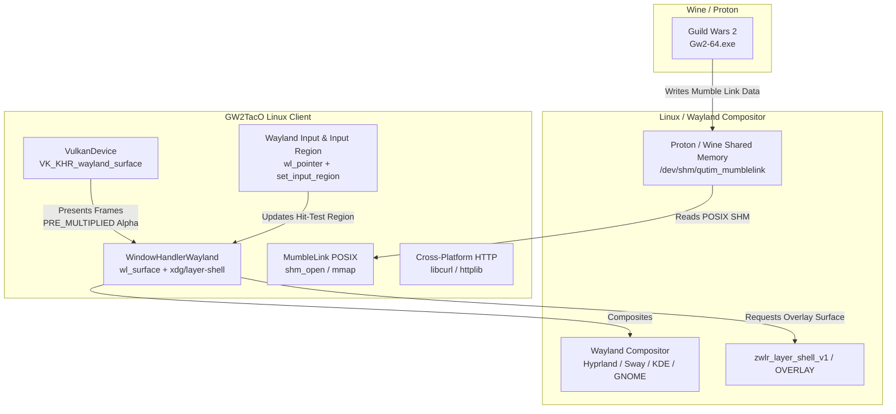

# GW2TacO Wayland on Linux Migration Plan

## 1. Executive Summary & Architecture Overview

The Vulkan renderer implementation in GW2TacO provides the foundation for running on Linux. Under Wayland, the compositing architecture differs significantly from Windows DWM:
- **Native Alpha Support**: Wayland natively treats surfaces as premultiplied alpha (`VK_COMPOSITE_ALPHA_PRE_MULTIPLIED_BIT_KHR`), eliminating Windows DWM DirectFlip alpha-stripping and colorkey workarounds.
- **Overlay Compositing**: Wayland does not permit arbitrary top-level floating windows or global Win32 hooks (`WH_MOUSE_LL`). Overlays are created using the `zwlr_layer_shell_v1` protocol (or XDG shell with subsurfaces), allowing full-screen transparent overlays on the `OVERLAY` layer.
- **Click-Through**: Managed per-frame using `wl_surface.set_input_region` based on whether the cursor is over active TacO UI elements or the game canvas.
- **Mumble Link on Linux**: Wine/Proton exposes Guild Wars 2 Mumble Link shared memory in `/dev/shm` (e.g. `/dev/shm/qutim_mumblelink.*` or via Wine IPC).



---

## 2. Migration Phases

### Phase 1: Build System & Toolchain Portability (CMake)
* **Goal**: Enable CMake to configure and compile on Linux using Clang 18+ / GCC 14+ with C++23 modules.
* **Key Tasks**:
  1. Remove hardcoded Windows properties in [CMakeLists.txt](file:///C:/Users/therjak/Source/Repos/GW2TacO/CMakeLists.txt) (`CMAKE_SYSTEM_VERSION`, MSVC runtime configurations, `/MP`, `/utf-8`).
  2. Add platform branches: `if (WIN32)` vs `if (UNIX AND NOT APPLE)`.
  3. Integrate Linux system dependencies:
     - `wayland-client`, `wayland-cursor`, `wayland-protocols`
     - `xkbcommon` (keyboard mapping)
     - `libcurl` (replacing `winhttp.h` and `urlmon.lib`)
  4. Generate Wayland protocol client headers via `wayland-scanner` for `xdg-shell` and `wlr-layer-shell-unstable-v1`.

### Phase 2: Vulkan Wayland Presentation Backend
* **Goal**: Extend [VulkanDevice](file:///C:/Users/therjak/Source/Repos/GW2TacO/src/core2/vk_device.h) to create Wayland surfaces.
* **Key Tasks**:
  1. Enable `VK_USE_PLATFORM_WAYLAND_KHR` when building on Linux.
  2. Implement `vkCreateWaylandSurfaceKHR` in `VulkanDevice::InitAPI`:
     ```cpp
     VkWaylandSurfaceCreateInfoKHR surface_info{
         .sType = VK_STRUCTURE_TYPE_WAYLAND_SURFACE_CREATE_INFO_KHR,
         .display = wayland_display,
         .surface = wayland_surface,
     };
     vkCreateWaylandSurfaceKHR(instance_, &surface_info, nullptr, &surface_);
     ```
  3. Swapchain configuration:
     - Select `VK_COMPOSITE_ALPHA_PRE_MULTIPLIED_BIT_KHR` (standard on Wayland compositors).
     - Format: `VK_FORMAT_B8G8R8A8_UNORM` or `VK_FORMAT_R8G8B8A8_UNORM`.

### Phase 3: Window Management & Wayland Layer Shell
* **Goal**: Implement `WindowHandlerWayland` replacing [WindowHandlerWin](file:///C:/Users/therjak/Source/Repos/GW2TacO/src/core2/window_handler.cpp).
* **Key Tasks**:
  1. Abstract `WindowHandler` to decouple Win32 `HWND`, `HINSTANCE`, and `MSG` event loops.
  2. Implement Wayland event loop (`wl_display_dispatch` / `wl_display_flush`).
  3. Configure `zwlr_layer_shell_v1`:
     - Scope: `ZWLR_LAYER_SHELL_V1_LAYER_OVERLAY`.
     - Anchor to all 4 screen edges: `TOP | BOTTOM | LEFT | RIGHT`.
     - Margins set to 0 to span the display output.
  4. Handle window resize via `zwlr_layer_surface_v1_configure` events.

### Phase 4: Input Routing & Dynamic Passthrough
* **Goal**: Replace Win32 global mouse/keyboard hooks (`WH_MOUSE_LL`, `WH_KEYBOARD_LL`).
* **Wayland Security Constraints**: Wayland does not permit apps to snoop global mouse events across other windows.
* **Strategy**:
  1. **Dynamic Input Regions (`wl_surface_set_input_region`)**:
     - When cursor is over TacO UI widgets (menus, buttons, windows), set `wl_surface_set_input_region` covering those widgets to capture clicks and drags.
     - For empty/transparent areas, pass an empty region `wl_region_create(display)` -> clicks fall directly into Guild Wars 2 underneath with zero latency.
  2. **Global Shortcuts**:
     - Use `xdg-desktop-portal` GlobalShortcuts or compositor-level keybindings to toggle UI visibility / focus.

### Phase 5: POSIX Mumble Link Integration
* **Goal**: Read player position and camera telemetry from Wine/Proton.
* **Key Tasks**:
  1. In `src/mumble_link.cpp`, abstract `OpenFileMappingA` / `MapViewOfFile`.
  2. Implement POSIX shared memory:
     ```cpp
     int fd = shm_open("/qutim_mumblelink", O_RDONLY, 0600);
     if (fd >= 0) {
       linked_mem_ = (LinkedMem*)mmap(nullptr, sizeof(LinkedMem), PROT_READ, MAP_SHARED, fd, 0);
     }
     ```
  3. Support Proton's custom shared memory prefixes if `/qutim_mumblelink` is mapped per-wineprefix.

### Phase 6: Subsystem Decoupling & Utilities
* **Goal**: Replace remaining Windows-specific APIs.
* **Key Tasks**:
  1. **HTTP Client** (`src/gw2_api.cpp`): Replace `winhttp.h` with `libcurl` or `cpp-httplib`.
  2. **Filesystem Paths**: Replace `SHGetFolderPath` (`CSIDL_APPDATA`) with XDG Base Directory specification (`$XDG_DATA_HOME/gw2taco` or `~/.local/share/gw2taco`).
  3. **Process Detection**: Replace `TlHelp32.h` process snapshots with scanning `/proc` for `Gw2-64.exe` or checking the active Wayland toplevel via `zwlr_foreign_toplevel_manager_v1`.

---

## 3. Recommended Execution Order

```
[Phase 1: CMake & Libcurl] ➔ [Phase 5: POSIX Mumble Link] ➔ [Phase 2: Vulkan Wayland Surface]
                                                                        │
                                                                        ▼
[Phase 4: Input Regions]   ◀── [Phase 3: Wayland Layer Shell] ◀─────────┘
```

1. **Step 1**: Modularize `CMakeLists.txt` for Linux and port HTTP (`libcurl`) so the core logic compiles on Linux.
2. **Step 2**: Implement the POSIX Mumble Link reader to verify telemetry reading from Proton.
3. **Step 3**: Implement `WindowHandlerWayland` + `VulkanDevice` Wayland swapchain and test transparent rendering via layer-shell.
4. **Step 4**: Implement dynamic `wl_surface_set_input_region` click-through.
